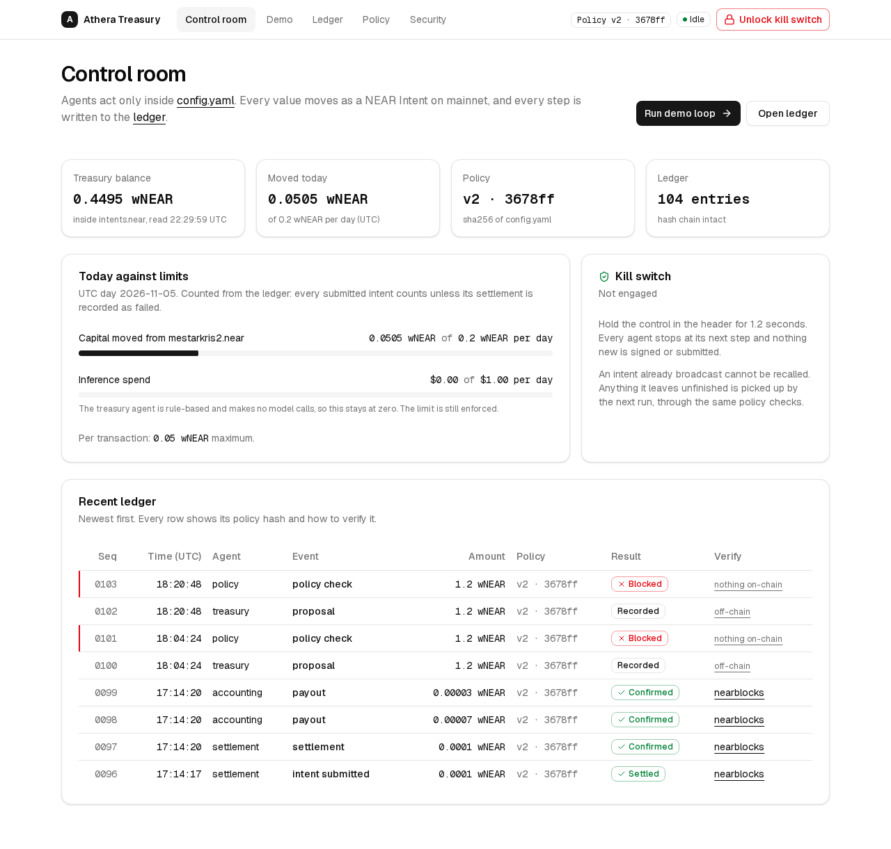

# Athera Treasury

A constrained, AI-native DAO treasury service for the NEAR Hackathon (Autonomous Business Track).
Humans set policy once in `config.yaml`. Agents act only inside that policy. Every movement of
value is a NEAR Intent, and every step is written to a hash-chained public ledger that anyone can
check against the chain.



## What this repository proves

One complete loop, run for real and repeatable:

1. **Treasury proposes:** the treasury agent proposes a transfer to an approved vendor.
2. **Policy check:** the policy engine checks it against `config.yaml`. It blocks it here if any rule fails, and **nothing is signed**.
3. **Intent created:** the settlement agent builds a NEAR Intent (NEP-413 signed `transfer` intent).
4. **Intent submitted:** it is submitted to `intents.near` with a scoped function-call key.
5. **Settlement confirmed:** the transaction is tracked to finality, and the verifier's own events confirm the intent hash.
6. **Fee collected:** accounting collects the fee as another policy-checked intent.
7. **Revenue split paid:** accounting pays the revenue split (70/30) as another policy-checked intent.

Every step above is appended to the ledger (`data/ledger.jsonl`). The kill switch can stop the loop
before any step.

Evidence from the runs in this repository (mainnet; see [docs/phase1-report.md](docs/phase1-report.md)
and [docs/phase2-report.md](docs/phase2-report.md)):

| Step | Transaction |
|---|---|
| Principal 0.01 wNEAR → vendor | [EpMiYuse…zy89RN](https://nearblocks.io/txns/EpMiYusecyJkG5CTNcscbD6N1uHMBY2wYkAGdKzy89RN) |
| Fee 0.0001 wNEAR → revenue | [DTj7oJ1n…WMAE](https://nearblocks.io/txns/DTj7oJ1nhthv44TC2sXZecH1hhKkaDKAWso9PPWDAMAE) |
| Revenue split 0.00007 + 0.00003 wNEAR | [7xMrFVgk…PbnE](https://nearblocks.io/txns/7xMrFVgkz6VaJLZpvqnaqFvzpz3pwvgRvRzKVzbPQbnE) |

The committed ledger holds 104 entries: 15 confirmed settlements, 6 blocked proposals and 2 kill-switch
halts (one from a separate operator process). `pnpm verify` re-checks all of it from public data
(below).

## Read this first: honest scope

- **NEAR mainnet, not testnet.** NEAR Intents has no testnet deployment. The loop runs against the
  production verifier `intents.near` with tiny amounts, capped at a 0.5 wNEAR deposit
  ([D1](docs/decisions.md), [D5](docs/decisions.md)).
- **No solver routing.** The loop uses same-asset `transfer` intents inside the verifier. Nothing is
  swapped or bridged, so no cross-chain movement is demonstrated ([D7](docs/decisions.md)).
- **The treasury agent is rule-based.** It turns an instruction into a proposal and makes no model
  calls. The inference-spend limit is enforced and tested but stays at $0 ([D8](docs/decisions.md)).
- **Sales and Procurement are stubs.** They are labelled `STUB` in code and not used by the loop. External
  "swarm" proposals are refused as untrusted by the policy engine (tested), but there is no swarm
  integration.
- **The ledger is a file on one server.** It is committed here, and the web app serves it. Public
  hosting is not set up yet ([D11](docs/decisions.md)).
- **Mobile has been checked in emulation only, not on a physical phone yet** ([D14](docs/decisions.md)).

## Quick start

Requires Node ≥ 22 and pnpm (`corepack enable`).

```bash
pnpm install
```

```bash
pnpm test
```

```bash
pnpm verify
```

`pnpm test` runs 84 tests, offline. `pnpm verify` needs only network access to public RPC: it
re-checks the committed ledger against mainnet and changes nothing.

To run the loop yourself you need your own funded NEAR mainnet account and wallet. Follow
[docs/setup.md](docs/setup.md): `pnpm keygen`, then `pnpm setup:wallet` (approve the setup
transactions in your wallet), then put your accounts in `config.yaml`. After that:

```bash
pnpm preflight
```

```bash
pnpm demo
```

```bash
pnpm demo:halt
```

```bash
pnpm halt --release
```

- `pnpm preflight` is read-only. It refuses to continue if a runtime key is full-access or mis-scoped.
- `pnpm demo` moves real funds (0.01 wNEAR + fee) in about 20 seconds and prints explorer and ledger links.
- `pnpm demo:halt` runs the same loop, but a separate process pulls the kill switch mid-loop.
- `pnpm halt --release` releases the kill switch. The next `pnpm demo` finishes any fee or split a halt left undone.

The web console:

```bash
pnpm web:build && pnpm web:start
```

It serves http://127.0.0.1:3000 on the server only; reach it over an SSH tunnel. Running loops and
using the kill switch from the browser need the operator token in `apps/web/.env.local`
(`ATHERA_OPERATOR_TOKEN`). Without it the app is read-only.

## Verify a settlement yourself

You need no access to our systems. Pick any `settlement` row in `data/ledger.jsonl` or on `/ledger`,
then either open its nearblocks link or ask any public RPC:

```bash
curl -s https://rpc.mainnet.fastnear.com -H 'content-type: application/json' -d '{"jsonrpc":"2.0","id":1,"method":"tx","params":{"tx_hash":"EpMiYusecyJkG5CTNcscbD6N1uHMBY2wYkAGdKzy89RN","sender_account_id":"mestarkris2.near","wait_until":"FINAL"}}'
```

Check that:

- `transaction.receiver_id` is `intents.near` and every receipt outcome is a success;
- a receipt log `EVENT_JSON` with standard `dip4` carries the ledger entry's `intent_hash`;
- its `transfer` event carries the memo `athera:<proposal id>:<first 8 hex of the policy hash>`, which
  ties the on-chain transfer to the exact policy version that approved it;
- the receipt's block height matches the ledger.

`pnpm verify` does all of that for every settlement. It also re-checks the ledger's hash chain, and
recomputes every recorded policy check (passes and blocks) from the ledger alone. Blocked proposals
have deliberately nothing on-chain, so recomputing the check is how you verify a block.

## How it works

```
config.yaml ─▶ PolicyEngine.load
                    │
TreasuryAgent.propose ─▶ PolicyEngine.validate ─▶ (block: ledger, stop; nothing signed)
                    │ pass (a check only the engine can create)
Settlement.create ─▶ sign (NEP-413) ─▶ simulate_intents ─▶ execute_intents (function-call key)
                    │
Settlement.track ─▶ finality + dip4 events ─▶ AccountingAgent: fee ─▶ validate ─▶ intent ─▶ split ─▶ …
Ledger.append at every step · kill-switch check before every step, before signing and before broadcast
```

| Package | Responsibility |
|---|---|
| `packages/policy` | `config.yaml` schema (Zod), pure rule functions, a version hash on every check, the kill switch |
| `packages/settlement` | NEP-413 signing, versioned nonces, NEAR transaction encoding (byte-identical to near-js, tested), RPC, the custody checks |
| `packages/agents` | Treasury and Accounting agents (proposals only), the orchestrator, reconciliation after a halt |
| `packages/ledger` | Append-only, hash-chained JSONL ledger |
| `apps/web` | Next.js console (Tailwind + shadcn/ui): control room, live demo timeline, ledger, entry detail, policy, security |
| `scripts/demo` | `demo`, `phase1`, `verify`, `preflight`, `halt`, `keygen` |

Where the non-negotiables are enforced:

- **Policy before any key.** A pass can only be created by `PolicyEngine.validate`.
  Settlement re-verifies it (copies, stale checks, reused checks, changed proposals and policy-hash
  mismatches are refused). Tests prove an invalid proposal never reaches the signer or the network
  (`packages/agents/test/orchestrator.test.ts`).
- **Agent boundaries.** A test fails if the treasury or accounting agent imports signing or
  settlement code.
- **Kill switch.** It is checked synchronously before every stage, before signing and before broadcast.
  A run can be halted from another process (proved in the ledger). A broadcast intent cannot be
  recalled; the next run finishes its fee and split through the same checks.
- **Ledger.** Every check, pass or block, plus every proposal, intent, settlement, fee, payout and
  halt. Entries are hash-chained, and the reader refuses a file whose history was edited.

## Policy

[`config.yaml`](config.yaml) holds:

- the per-transaction and per-day movement limits;
- the daily inference budget;
- the approved chain, asset and protocol;
- the minimum reserve and maximum drawdown;
- the fee (100 bps, minimum 0.0001);
- the revenue split (70/30);
- the approved counterparties;
- the kill-switch flag.

It changes only through a commit. Every check records the version and the SHA-256 of the file's
exact bytes; the `/policy` page shows the versions used and the git history.

## Custody and security

- **No full-access key is held by any Athera process.**
  - The treasury runtime key is a function-call key that may call only `intents.near.execute_intents`
    (0.25 NEAR gas allowance), also registered as the treasury's intent signer.
  - The revenue key exists only inside the verifier.
  - The owners' full-access keys stay in their wallet ([D4](docs/decisions.md), [D9](docs/decisions.md), [D10](docs/decisions.md)).
- **Where secrets live:** runtime keys are in `.env` (mode 600, gitignored). `pnpm keygen` prints public
  keys only. A pre-commit hook rejects private-key-like strings. The web server never loads signing
  keys; runs are separate processes.
- **What a stolen runtime key could do:** sign any intent for the treasury's balance inside
  `intents.near` without going through the policy engine. Exposure is capped by the deposit, and
  the key cannot move the account's NEAR or call other contracts.
- **Not in scope:** TEE or hardware custody (OutLayer was not used), multi-RPC consensus, and protection
  against a malicious server operator rewriting the whole ledger file. Settlements remain
  checkable against the chain; off-chain entries such as blocks do not.

The `/security` page shows the live on-chain keys for both accounts, so these claims can be
checked against the chain.

## Documentation

- [docs/decisions.md](docs/decisions.md): every judgement call, D1–D16.
- [docs/setup.md](docs/setup.md): accounts, keys, wallet approvals.
- [docs/design.md](docs/design.md): the UI (Tailwind + shadcn/ui) and the rules it keeps.
- [docs/review-phase6.md](docs/review-phase6.md): the interface guidelines review and accessibility scan.
  Since the switch to shadcn/ui (D16), the scan still reports 0 violations; the AI-look checklist there applied to the previous design.
- [docs/Athera_Treasury_Architecture_Blueprint.pdf](docs/Athera_Treasury_Architecture_Blueprint.pdf):
  the original blueprint.

## Known gaps against the brief

| Brief item | Status |
|---|---|
| Testnet demo | Mainnet with tiny amounts: there is no NEAR Intents testnet (D1) |
| `/ledger` first-load JS < 120 KB gz | 153.2 KB. The Next.js framework alone is ~125 KB, and the switch to Tailwind + shadcn/ui (D16) added ~13 KB; `/demo` is 154.6 KB |
| Mobile checked on a device | Emulation and automated checks only so far |
| Public ledger hosting | Not deployed yet |
| Solver-routed or cross-chain intents | Not demonstrated (D7) |
